# Hotel Booking Demand: Data Preprocessing & Feature Engineering

Turning 119,390 real hotel bookings into clean, leakage-free, model-ready data, with every
decision explained.


> **Live web app:** _coming soon - deployed in a later step_
> &nbsp;|&nbsp; **Decisions log:** [`docs/decisions.md`](docs/decisions.md)
> &nbsp;|&nbsp; **Walkthrough notebook:** [`notebooks/eda.ipynb`](notebooks/eda.ipynb)

VoidMain Technologies AI Internship - **Task 2: Data Analysis, Preprocessing & Feature
Engineering.**

---

## Overview

Real-world data is messy. This project takes the public *Hotel Booking Demand* dataset and
prepares it for a machine-learning model that would predict **booking cancellations**
(`is_canceled`). No model is trained here - the goal is the data work that comes before:

1. **Understand** the data - types, missing values, duplicates, odd values
2. **Clean** it - missing values, duplicates, invalid rows, outliers
3. **Engineer** new features and **explore** them (EDA)
4. **Select** features - remove leakage and redundancy
5. **Encode and scale** with a scikit-learn pipeline fitted on training data only
6. **Document** every decision, and ship a web app that applies the same pipeline to new data

Everything runs with one command: `python main.py`.

## Results at a glance

| | Raw | Model-ready |
|---|---:|---:|
| Rows | 119,390 | **87,208** (69,766 train / 17,442 test) |
| Missing cells | 129,425 | **0** |
| Exact duplicate rows | 31,994 | removed |
| Invalid rows (0 guests, negative price, impossible counts) | 202 | removed |
| ADR (daily rate) max | 5,400 | **335** (capped at 99.9th pct) |
| Cancellation rate | 37.0% | 27.5% (duplicates were mostly canceled group blocks) |
| Columns / features | 32 columns | **33 inputs -> 86 model features** |

## Dataset

**Hotel booking demand** - Nuno Antonio, Ana de Almeida, Luis Nunes (2019).
*Hotel booking demand datasets.* Data in Brief, 22, 41-49.
[doi.org/10.1016/j.dib.2018.11.126](https://doi.org/10.1016/j.dib.2018.11.126)

- Real bookings from two hotels in Portugal (a city hotel and a resort hotel), arrivals
  between July 2015 and August 2017. Personal identifiers were removed by the authors.
- 119,390 rows x 32 columns; target `is_canceled` (1 = canceled).
- Downloaded from the public [TidyTuesday mirror](https://github.com/rfordatascience/tidytuesday/tree/main/data/2020/2020-02-11)
  (same data as the Kaggle version, no login needed) and committed as
  `data/raw/hotel_bookings.csv` for reproducibility. `src/download_data.py` re-downloads and
  verifies it if it is missing.
- **Why this dataset:** it has every real-world problem the brief asks for - structural missing
  values, a quarter of the rows duplicated, impossible values, a 177-country categorical column
  and two columns that leak the target.

## Pipeline

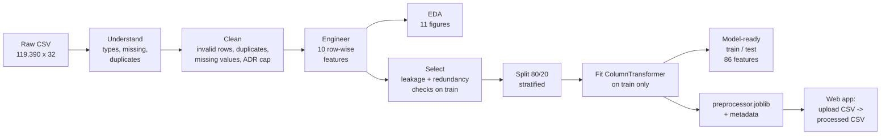

| Step | What happens | Code |
|---|---|---|
| Understand | Shape, types, missing %, unique counts, data-quality snapshot | `src/load_data.py` |
| Clean | 10 ordered steps, each logged with rows removed / values changed | `src/cleaning.py` |
| Engineer | `total_nights`, `adr_per_person`, `previous_cancel_ratio`, ... | `src/features.py` |
| EDA | Shared aggregation layer + one consistent plot style | `src/eda.py`, `src/visualize.py` |
| Select | Target-purity leakage check, correlation, near-constant checks | `src/features.py`, `src/pipeline.py` |
| Encode + scale | `log1p` where it helps, `StandardScaler`, `OneHotEncoder` with rare-category grouping | `src/pipeline.py` |

## Key preprocessing decisions

Full reasoning, numbers and the alternatives considered: [`docs/decisions.md`](docs/decisions.md).

| Problem | Decision | Why |
|---|---|---|
| `"NULL"` text in `agent`, `company`, `country` | Read as missing | Otherwise 100k+ gaps hide as a fake category |
| `company` 94% missing | Replace with `has_company` flag | Missing = "no company"; the ID itself is too sparse |
| `agent` 14% missing | Fill `0` + `has_agent` flag | Missing = booked directly, not unknown |
| `country` / `children` missing | `"Unknown"` / `0` | Honest label; 4 rows only |
| 31,980 exact duplicates | Dropped (before recoding columns) | Copies across train/test leak answers; trade-off documented |
| 180 zero-guest bookings, 1 negative ADR | Dropped | Not real stays / prices |
| `adults` = 55, `babies` = 10, ... | Dropped via a gap rule, not IQR | IQR of count columns is 0 and would flag 8,590 families |
| ADR max 5,400 | Capped at 99.9th percentile (335) | IQR would cap 3,793 real peak-season prices |
| `reservation_status`, `assigned_room_type`, `booking_changes` | Dropped as leakage | Known only at/after the outcome |
| Week number vs month, week nights vs total nights | One of each pair dropped | \|r\| = 0.995 and 0.95 |
| Encoders and scaler | Fitted on the training split only | No test statistics leak into training |
| New data (web app) | Reuses training ADR cap + fitted pipeline | Treated exactly like the training data |

## EDA insights

Computed on the cleaned data (87,208 bookings; overall cancellation rate 27.5%).

**1. The earlier the booking, the more likely it is canceled** - 8% within a week vs 41% a year ahead.

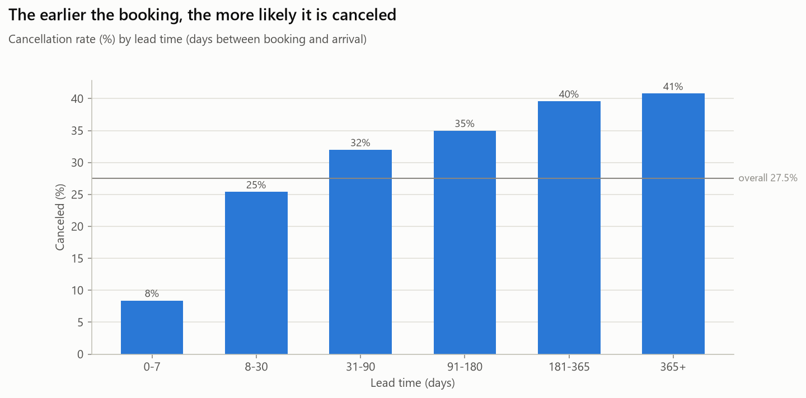

**2. Non-refundable deposits and online travel agents cancel most.** The 94.7% for
non-refundable bookings looks wrong but is explained by the data: 63% are group blocks booked
~188 days ahead through agents, then released.

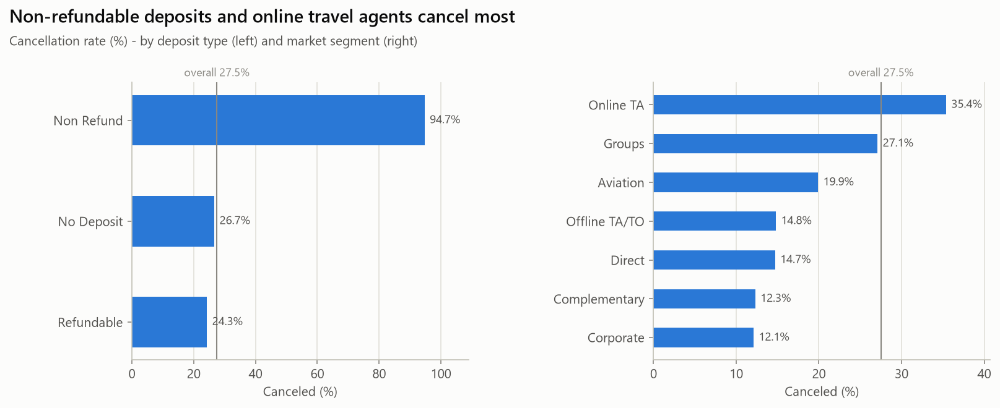

**3. Special requests signal commitment** - 33% canceled with none, 6% with five.

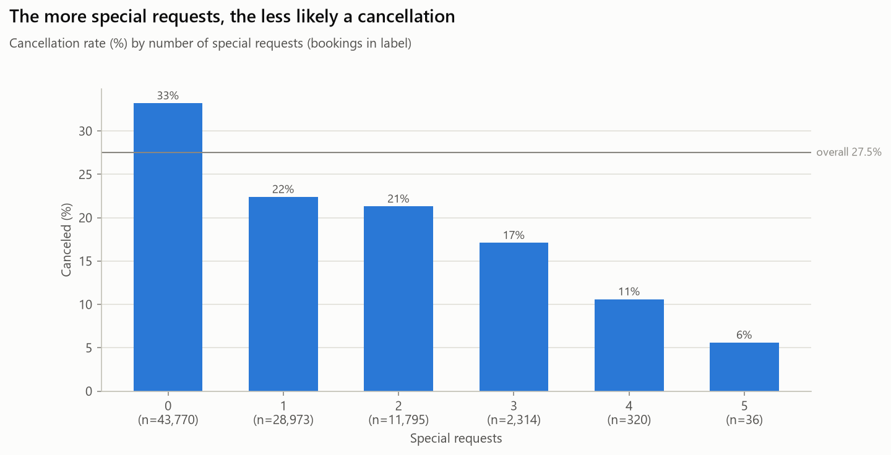

**4. The resort hotel is seasonal, the city hotel is not** - resort prices rise from ~49 EUR
in January to ~187 EUR in August, and its cancellations peak in summer.

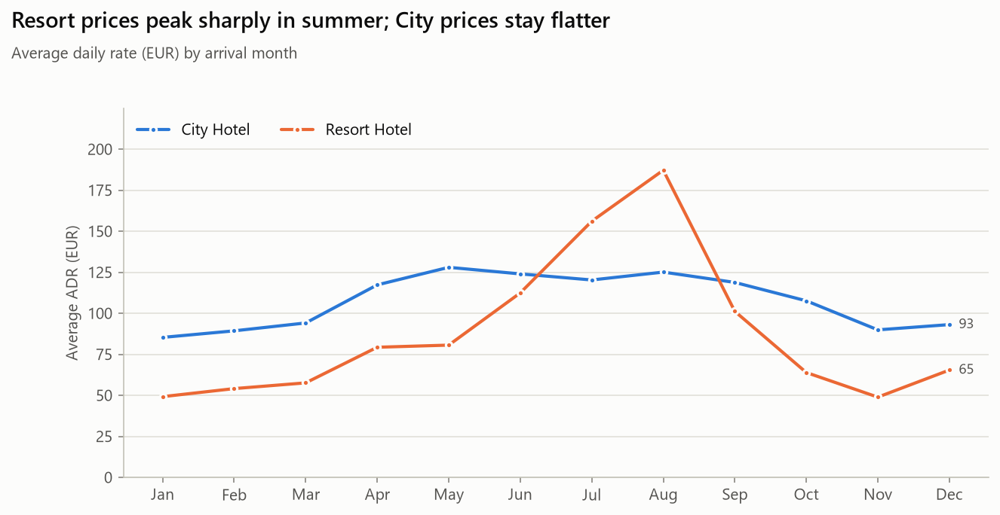

**5. Duplicates were not random** - removing them changes the cancellation rate, so the
trade-off is documented rather than hidden.

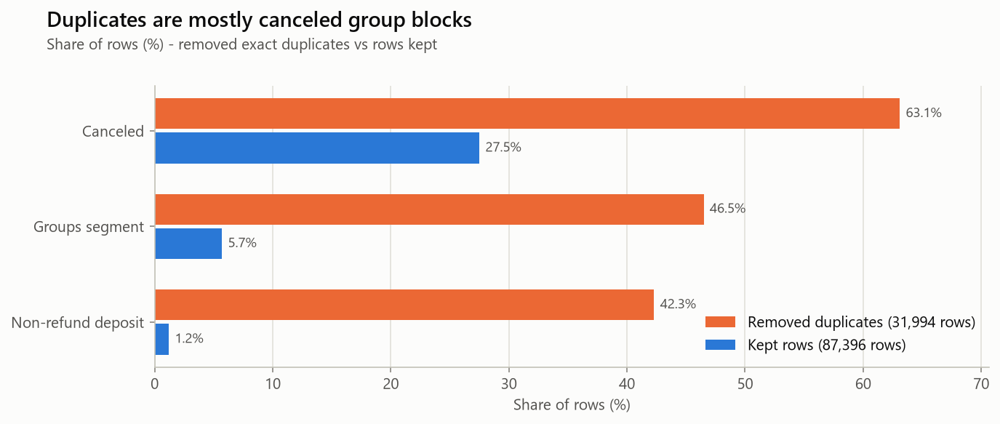

<details>
<summary>All 11 figures</summary>

| | |
|---|---|
| 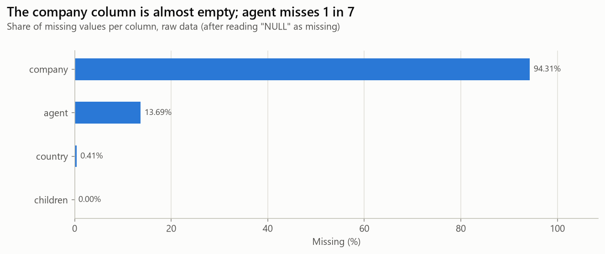 | 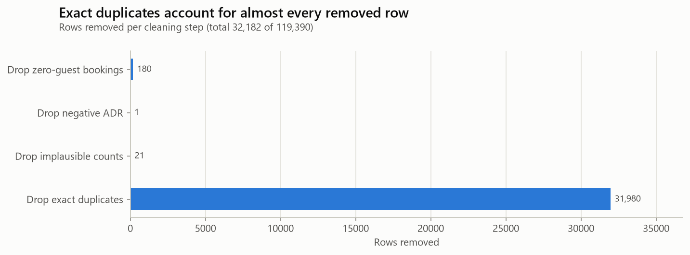 |
| 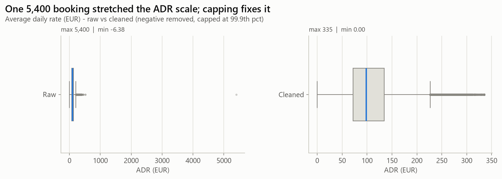 | 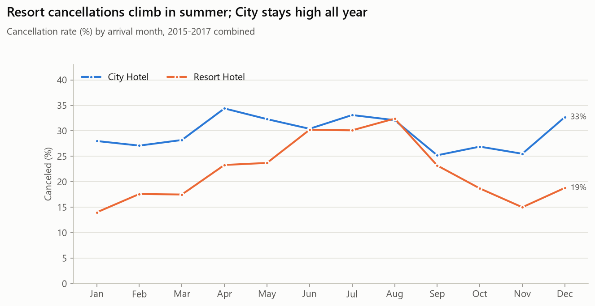 |
| 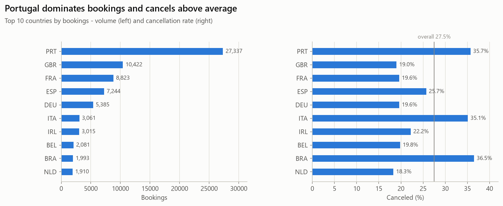 | 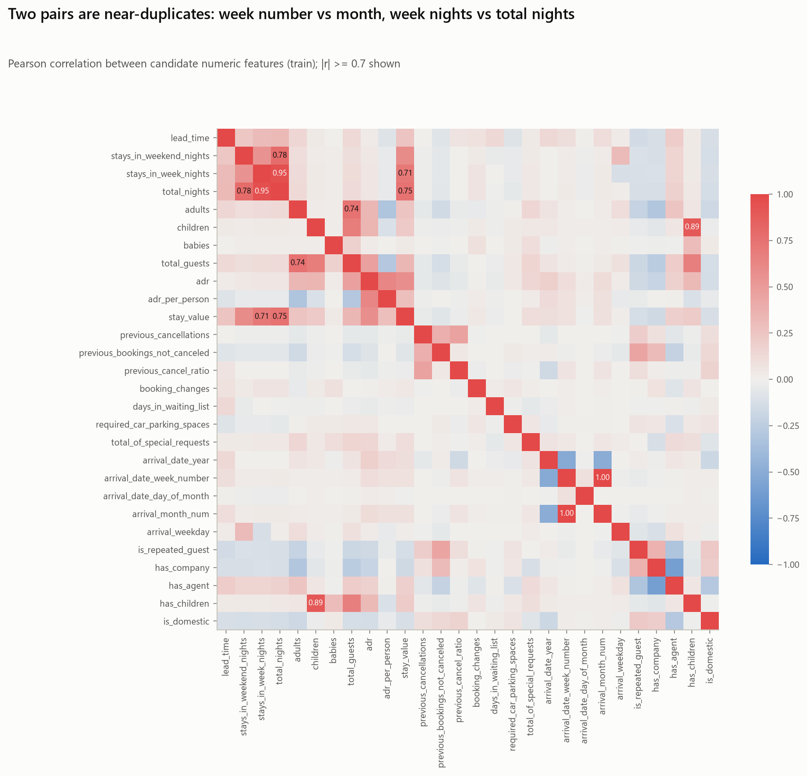 |

</details>

## Final features

33 model inputs, 86 columns after one-hot encoding (`models/preprocessing_metadata.json`
lists them all).

| Type | Features | Transform |
|---|---|---|
| Numeric (18) | lead_time, stays_in_weekend_nights, total_nights, adults, children, total_guests, adr, adr_per_person, stay_value, previous_cancellations, previous_bookings_not_canceled, previous_cancel_ratio, days_in_waiting_list, required_car_parking_spaces, total_of_special_requests, arrival_date_day_of_month, arrival_month_num, arrival_weekday | `StandardScaler` (5 skewed ones get `log1p` first) |
| Binary (5) | is_repeated_guest, has_company, has_agent, has_children, is_domestic | unchanged (0/1) |
| Categorical (10) | hotel, meal, market_segment, distribution_channel, reserved_room_type, deposit_type, customer_type, arrival_season, country, agent | `OneHotEncoder`, categories < 1% -> "infrequent" |

**Engineered (10):** total_nights, total_guests, has_children, adr_per_person, stay_value,
arrival_month_num, arrival_weekday, arrival_season, is_domestic, previous_cancel_ratio.

## How to run

Requires Python 3.14 (see `.python-version`).

```bash
git clone https://github.com/<your-username>/hotel-booking-preprocessing.git
cd hotel-booking-preprocessing
python -m venv .venv
.venv\Scripts\activate            # Windows  (macOS/Linux: source .venv/bin/activate)
pip install -r requirements-dev.txt
```

| Command | What it does |
|---|---|
| `python main.py` | Full pipeline: raw CSV -> clean -> features -> figures -> selection -> model-ready data (~10 s) |
| `python main.py --skip-figures` | Same, without regenerating figures |
| `pytest` | Run the 60 tests |
| `ruff format --check . && ruff check .` | Formatting and lint checks |
| `jupyter nbconvert --execute --inplace notebooks/eda.ipynb` | Re-run the walkthrough notebook |

**Outputs**

| File | Content |
|---|---|
| `data/processed/hotel_bookings_clean.csv` | Cleaned data (generated, not committed) |
| `data/processed/train_processed.csv`, `test_processed.csv` | Model-ready matrices + target (generated) |
| `models/preprocessor.joblib` | Fitted `ColumnTransformer` |
| `models/preprocessing_metadata.json` | Feature lists, ADR cap, split sizes, versions |
| `reports/figures/*.png` | 11 EDA figures |

## Project structure

```
data/raw/               original CSV (never modified)
data/processed/         cleaned + model-ready output (generated)
docs/decisions.md       every preprocessing decision, with reasons and alternatives
models/                 fitted preprocessor + metadata
notebooks/eda.ipynb     walkthrough, runs top to bottom with saved outputs
reports/figures/        11 EDA figures
src/
  config.py             paths, URLs, column lists, thresholds, random_state
  download_data.py      download + verify the raw dataset
  load_data.py          loading and data-understanding summaries
  cleaning.py           missing values, duplicates, invalid rows, outliers
  features.py           feature engineering + feature-selection checks
  eda.py                EDA aggregations (shared by figures and web app)
  pipeline.py           split, encoding + scaling, saved artifacts, new-data transform
  visualize.py          shared plot style and figures
tests/                  pytest suite (60 tests)
main.py                 runs the whole pipeline
```

## Tech stack

Python 3.14 · pandas · NumPy · scikit-learn · matplotlib · joblib · pytest · ruff

## Author

**Krishna** - B.Tech AI & ML student, AI intern at VoidMain Technologies.
GitHub: [@Krishna141414](https://github.com/Krishna141414)
